# EOLab

EOLab is a shared browser workspace for exploring, mapping and analyzing
geospatial data. Search a Catalog, bring your own polygons, compare maps through
time, calculate statistics and run models without installing a desktop GIS.

It is especially useful for workshops and collaborative analysis. A facilitator
can publish the participants' datasets once, and everyone can explore the same
material in real time without installing a desktop GIS or creating an account.

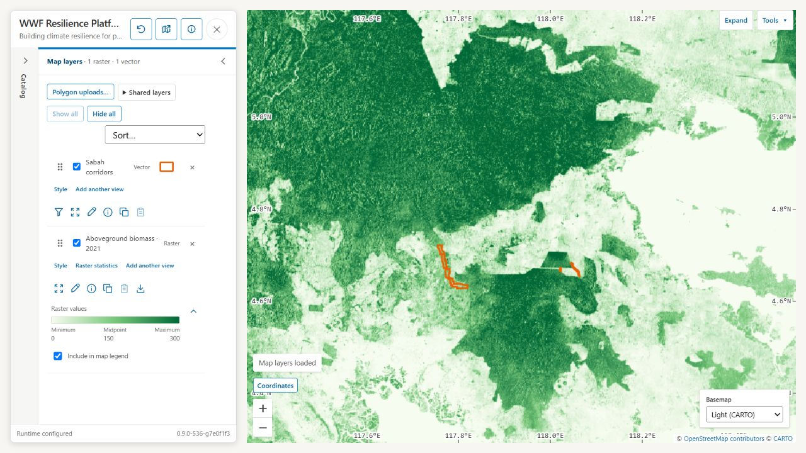

*Combine a biomass map with corridor polygons to explore the landscape around
the places you are studying.*

## What can you do with EOLab

**[Find data](#find-data):** Find shared raster, vector and temporal datasets in
a searchable Catalog built on the SpatioTemporal Asset Catalog (STAC) standard.

**[Explore data](#explore-data):** Combine layers and change colors, ranges,
transparency, categories and labels to make patterns easier to see. Click to
inspect features and pixels, and compare distributions with histograms.
Calculate values, areas and custom formulas for a box or selected polygons,
compare rasters in charts, and download the results.

**[Slice through time](#slice-through-time):** Explore data time cubes by choosing
individual observations or summarizing a period into a map. Calculate a time
series of the mean, maximum or standard deviation within a custom area, such as
a watershed defined by an uploaded polygon.

**[Clip and download data](#clip-and-download-data):** Extract raster data for a
sampling box or selected polygons and download a GeoTIFF that preserves the
original resolution and values, ready for further analysis.

**[Estimate downstream beneficiaries](#estimate-downstream-beneficiaries):**
Use a population dataset to estimate how many people live downstream of
selected areas, such as proposed restoration sites. Map the downstream coverage
and summarize the population within it.

**[Assess ecosystem condition](#assess-ecosystem-condition):** Compare observed habitat
conditions with those expected from selected reference sites. Map their
similarity to identify places whose condition differs from comparable reference
areas.

**[Collaborate with others](#collaborate-with-others):** Publish a map link so
others can explore your layers and see saved contributions in shared polygon
layers. Draw polygons with names and notes, or upload and filter your own
project boundaries.

## A quick tour

### Find data

Use **Catalog search** to enter any part of a filename, path, description, or
date. Ordinary words can be combined with these filters:

- `type:raster` — only raster datasets
- `type:vector` — only vector datasets
- `type:temporal` — datasets containing observations over time
- `format:cog` — only Cloud Optimized GeoTIFFs
- `date:2020`, `date:2020-06`, or `date:2020-06-15` — a year, month, or day
- `date:2020-01..2020-03` — an inclusive date range

For example, `resistance type:raster date:2020` finds raster records containing
“resistance” from 2020. Suggestions appear while you type. Clear the search to
show the complete Catalog, or use **Surprise me** to open a random matching
item.

Each result shows the source filename and the actions you are most likely to
need:

- **Add to map** displays the dataset.
- **More details** opens its Catalog metadata.

After an item is on the map, the same row also offers **Remove**, **Zoom to**,
and **Style** without making you leave the search results.

### Explore data

#### Build and style the map

Open **Map layers** to see the current stack. The first layer in the list draws
on top. Drag a row by its handle to reorder it, or use the keyboard controls on
the same handle.

Use a layer's checkbox to show or hide it, **Zoom to** to find it, and the color
swatch to open its legend. **Add another view** gives the same dataset another
independent set of display choices. **Copy style** and **Paste style** help keep
comparable layers consistent.

Open **Style** to bring out the pattern you care about:

- For continuous rasters, choose a palette and adjust its low, middle and high
  values, colors and transparency. A percentile stretch uses the sampled
  distribution to spread colors across a useful range instead of letting a few
  extreme values dominate.
- For categorical rasters, give classes such as land-cover types their own
  names and colors. Category tables can be imported from CSV.
- For vectors, use one symbol, categories, or numeric classes with editable
  breaks. Turn on **Show labels** when names or values help explain the map.

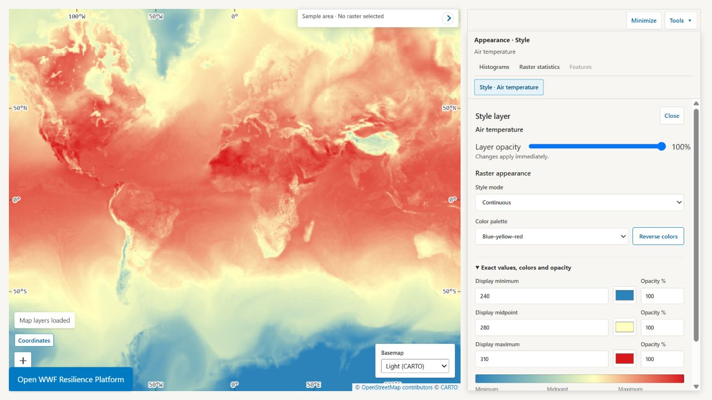

*Choose class breaks and colors to reveal differences between polygons.
Styling changes the appearance of your map, leaving the original values intact.*

#### Inspect features, pixels and distributions

A normal click explores the visible data at that location. Dragging still pans
the map.

For visible vectors, EOLab highlights the features under the click and opens
their attributes in **Feature inspector**. Use **Previous** and **Next** when
several features overlap. Clicking empty space does not open an empty result.

For rasters, inspect the value at the clicked pixel or open **Histograms** in
**1D** mode to see how values are distributed within a sampling box. Move or
resize the box to explore another area. Each visible raster has its own chart.

Use **Axes & scale** to inspect a useful range or switch to logarithmic axes
when values span several orders of magnitude. These controls change the chart
display. They do not change the sampled data or the map's colors.

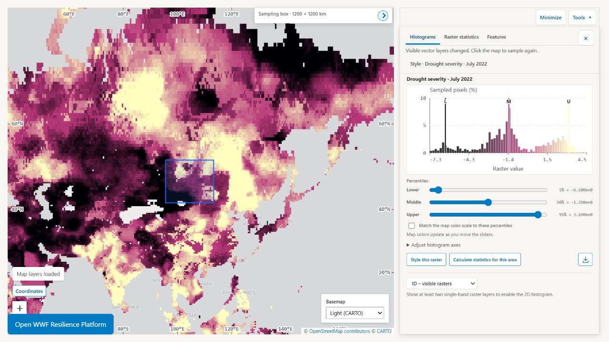

*Explore July 2022 drought-severity values across Asia. The box identifies the
sampled area; the histogram shows which values are common there.*

#### Compare category areas

Categorical rasters represent named classes, such as biomes or land-cover types.
Hover over the map to read a class name and code. With box sampling selected,
click the map to compare how much of the sampling area each class covers.

The chart shows estimated ground area in hectares and each class's percentage
of valid area inside the sampling box. Missing-data pixels are excluded; valid
values without a matching category are included as **Unmapped**. Move or resize
the box to compare another place.

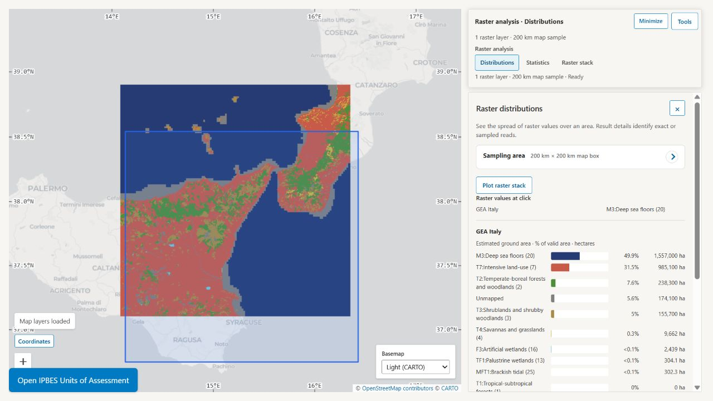

*Compare the relative areas of biome classes in a 200 km sampling box. The blue
box marks the sampled area; the bars include both land and marine classes.*

#### Compare two rasters

Choose **2D** in Histograms to compare the top two visible continuous rasters.
Map layers marks them **X** and **Y**. Reorder the rasters to choose the pair,
or swap the axes in the analysis panel. Other layers stay in Map layers but are
temporarily hidden while the comparison is active.

The joint histogram shows which pairs of values occur together within the same
sampling area. A coordinated map palette combines both rasters in one color,
helping you locate those combinations on the map.

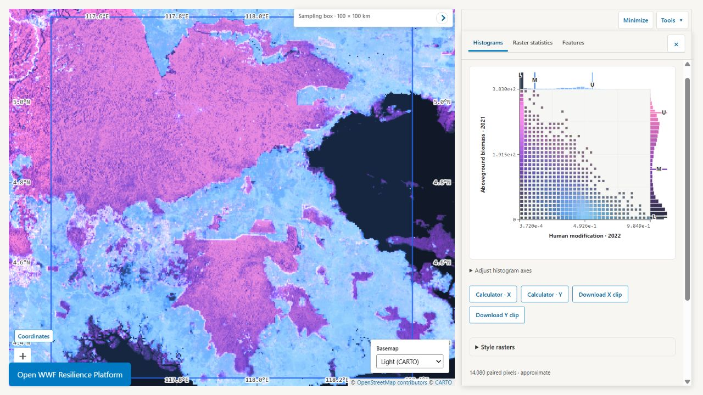

*Compare human modification and biomass in the same 100 km sampling window.
Larger squares show more common combinations; the outer histograms
show each raster's distribution.*

Adjust the palette and each raster's color range to explore the comparison.
Returning to **1D** restores the individual raster styles. Use **Raster
statistics** when you need calculated area totals or formulas.

#### Measure an area and compare rasters

Open **Raster statistics** from a layer or **Tools**. Choose the raster inputs,
an area and the statistic you want. One result is shown as a value; several
results can be compared in plots and a table, then downloaded as CSV.

Use a sampling box, selected polygons or each raster's whole extent, depending
on the question. For example, compare mean biomass inside project boundaries,
or measure how many hectares exceed a chosen threshold. Hidden raster layers
can still be selected as calculation inputs.

The built-in choices cover common statistics, counts, areas and percentages.
For a custom formula, `a` means each selected raster in turn:

| Question | Formula |
| --- | --- |
| What is the average valid value in this area? | `mean(a)` |
| How many hectares have values above 10? | `areaha(a > 10)` |
| What percentage of valid pixels have values above 10? | `100 * count(a > 10) / count(a)` |
| What was the value at my last map click? | `pixelValue(a)` |

Choose thresholds in the raster's own units. Missing-data pixels are excluded.
**Pixel value** always refers to the clicked location; changing the analysis
area does not turn it into an average. Up to five formulas can be calculated
together for each raster. The tool's formula reference explains the available
functions.

The **Raster summary** tool in **Tools → Data tools** also calculates a statistic
or formula for a raster and area.

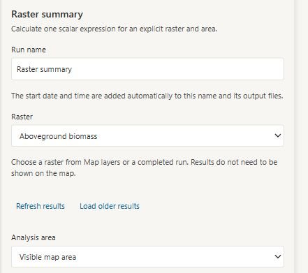

*Choose the raster and analysis area before setting the summary formula further
down the card.*

#### Make a series plot

After selecting vector features, the inspector offers two complementary plots:

- **Plot fields from this feature** graphs several numeric attributes from the
  current feature. This fits data where fields such as `R2000` through `R2024`
  contain a series within each feature.
- **Plot one field across features** graphs one numeric attribute for every
  feature available through **Previous** and **Next**. Choose the X-axis field
  or filename order, ascending or descending order, and a line or scatter
  chart.


Selecting a chart point identifies its source layer and offers **Zoom to source
layer**. EOLab remembers the plot rules while you inspect other features from
the same layer, so the chart updates instead of making you configure it again.

### Slice through time

A data time cube brings observations from different dates together as one
dataset. Search with `type:temporal`, add a dataset, and choose its **Variable**,
**Month** and **Date and time (UTC)** in Map layers. Only available observations
are listed. **Add another view** lets you compare dates or variables with
independent styles.

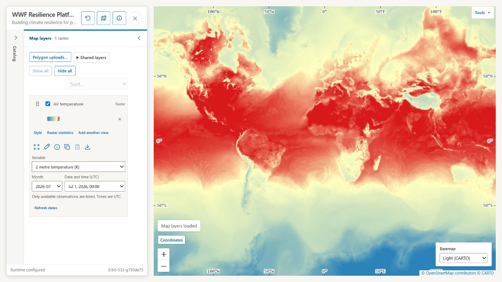

*Follow changing weather by choosing another hour or variable from the same
dataset. Here, blue shading shows rainfall at one available observation time.*

To go beyond one observation, open **Tools → Data tools**.

#### Create a raster from a time series

Summarize observations across your chosen dates into a raster, with a second
map showing how many observations contributed.

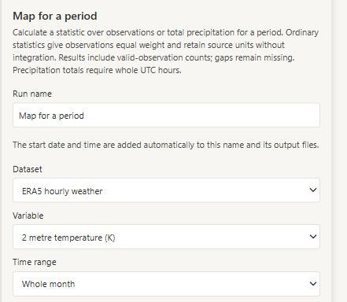

*Start with a dataset and variable, then choose the dates and statistic further
down the card.*

#### Time series for an area

Calculate a spatial statistic for each observation and download a CSV. For
example, follow mean temperature within a watershed over time.

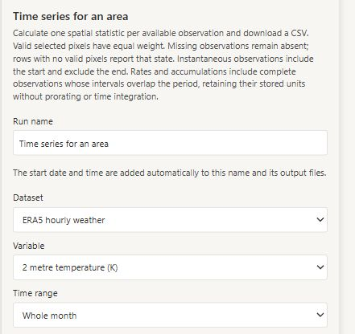

*Choose the observations to use before selecting the analysis area and its
statistic further down the card.*

**Raster statistics** also compares observations as a plotted series. Select
the dates for the calculation explicitly; they are independent of the single
observation currently displayed on the map. Missing observations are not filled
in, so check coverage before interpreting a trend or period summary. Ordinary
period statistics weight available observations equally; use **Precipitation
total** when offered to turn rainfall rates into an accumulated depth.

### Clip and download data

Open **Tools → Data tools** and choose **Raster clip** to extract the part of a raster
you need. Choose a raster and a sampling box or selected polygons, then download
the result as a GeoTIFF. The clip preserves the original pixel resolution and
values, ready for further analysis in GIS software. For example, extract biomass
data within a project's boundary instead of downloading the whole regional
dataset.

#### How do I download a clip?

1. Add a raster to **Map layers**, then pan and zoom to the area you need.
2. Open **Tools → Data tools** and choose **Raster clip**.
3. Give the run a name, choose **Raster**, and set **Analysis area** to
   **Visible map area**. Choose **Sampling box** to use the box shown on the map,
   or choose a vector layer directly to use its selected polygons.
4. Select **Run tool** and follow its progress in **Runs**.
5. When the run is ready, select **Download** under **Clipped raster** to save
   the GeoTIFF.

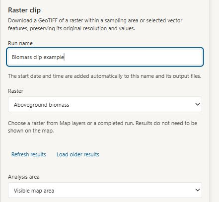

*Name the clip and choose its raster and area. This example clips biomass data
to the visible map area.*

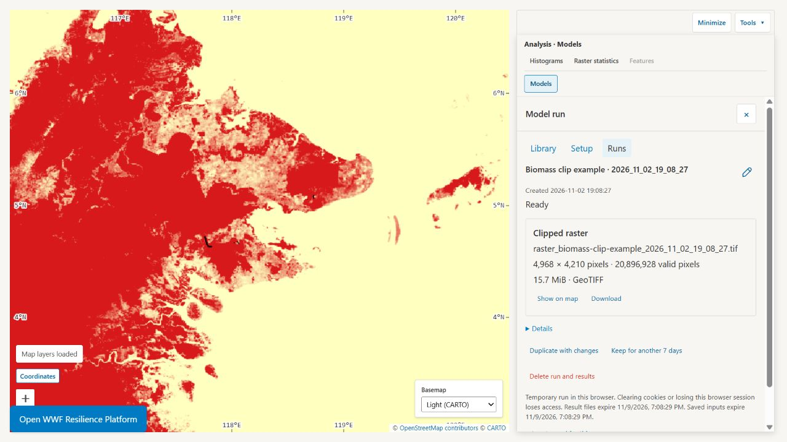

*The completed run offers a GeoTIFF download. Save files you need before the
expiry shown in the run.*

### Estimate downstream beneficiaries

Open **Tools → Data tools** and choose **Downstream ecosystem beneficiaries** to
explore which places lie downstream of a starting area and summarize what is
there. Choose polygons or a raster mask for **Starting mask**, then a raster for
**Values to summarize**, such as a population dataset. The model follows water
flow using elevation and watershed data. Adjust **Buffer radius** and the
optional **Maximum straight-line distance** to choose the coverage used for the
calculation. Values are resampled onto the model's calculation grid, and only
positive values are included.

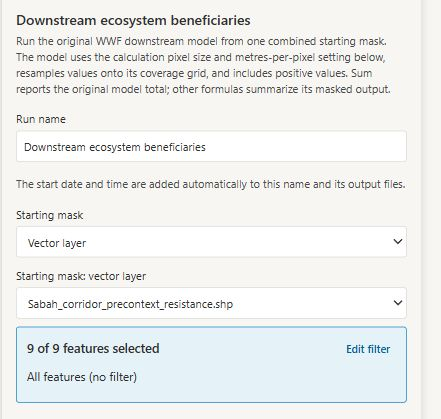

*Choose a starting mask. Selecting a polygon layer shows how many features will
be included; the values layer and calculation settings follow below.*

Results include a downstream coverage map, a map of the selected values within
that coverage, and summary statistics. With population counts as the values and
the default sum, you can estimate how many people live within the modeled
coverage downstream of proposed restoration sites. This identifies potential
beneficiaries; it does not measure how much benefit each person receives. You can
also choose another values raster or summary formula to explore a different
downstream question.

### Assess ecosystem condition

Open **Tools → Data tools** and choose **Ecosystem Condition** to assess how closely a
landscape resembles conditions expected from selected reference sites. Choose an
analysis area, reference sites, environmental predictor rasters and observed
habitat-response rasters. The model learns the relationship between the
environment and habitat responses at the reference sites inside that area, then
compares observed responses elsewhere with those expected under reference
conditions.

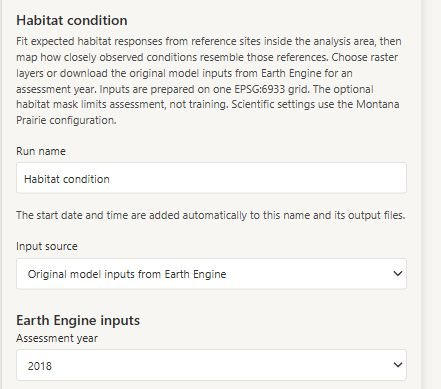

*The Ecosystem Condition card starts with the input configuration. Earth Engine mode also offers
an assessment year; area and reference-site choices follow below.*

The **Reference similarity** map shows the result on a scale from 0 to 1: higher
values indicate greater similarity to reference conditions. Downloadable
diagnostics help you examine the expected responses and departures from them.
For example, use the map to identify places whose observed condition differs
from what comparable reference sites suggest. Interpretation depends on your
reference sites and input data.

The default **Original model inputs (Google Earth Engine)** configuration uses
the [NHI Terrestrial Integrity Modeling](https://github.com/springinnovate/nhi-terrestrial-integrity-modeling)
inputs for your selected **Assessment year**. Setup links to each dataset's
catalog page. The first run downloads inputs for your area; later runs reuse
matching cached tiles. Choose **Choose raster layers** to supply your own stack.

Administrators can open **Manage cached inputs** in Habitat setup, or the Habitat
section of `/admin-eolab`, to choose named Catalog polygon areas and assessment
years. **Check cached inputs** reports current availability; **Prepare inputs**
queues downloads without running the model. Preparation continues after closing
the page. Return to administration to check progress, cancel or retry work, and
download completion reports while the configured job retention permits.

### Collaborate with others

#### Share your map

Choose **Publish map** in the workspace header, enter a title and link name,
then select **Create map link**. The resulting page opens your chosen layers,
styles, order, visibility and starting view so others can explore the map
without the Catalog panel.

Include a shared polygon layer so people opening the map can see everyone's
saved contributions immediately. Shared layers stay live as people save changes.

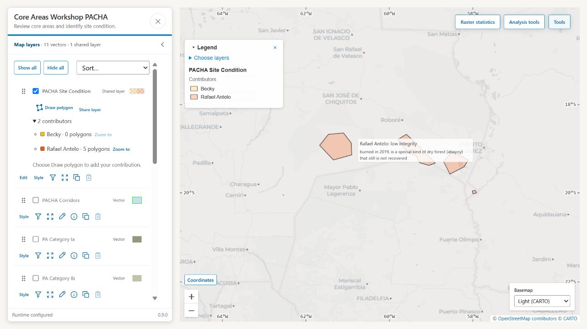

*A shared workshop map brings saved polygons, contributor names and notes into
one view. Everyone can see the contributions; each person edits only their own.*

Older **Copy map link** views may use a link that stores the view directly in
the URL.

The browser also remembers the last valid map on that deployment. **Reset
view** returns to an empty map and the configured starting position. **Undo
reset** restores the immediately previous map.

Map links do not include private local polygons, editing access,
histogram results, feature plots or processing jobs. Private uploads remain
private, and model-result previews must be reopened from **Runs**. Maps use the
site's current datasets; missing data can prevent full restoration.

#### Draw and share polygons

Use **Shared layers → Create layer** to start a shared polygon layer, or **Join
layer** with a share code and your contributor name. Draw polygons, edit their
boundaries, and add names and notes. Everyone sees the saved polygons; you can
edit only your own. **Share layer** copies the code for someone else to join.

If you arrived through a shared map link, choose **Draw polygon** on its shared
layer and enter your contributor name when asked to add your own polygons.

**Import GeoJSON** brings simple polygons into an editable local layer saved on
your device. It accepts WGS84 longitude/latitude Polygon features without holes,
including names and notes. Other file attributes and styles are not imported.
Use **Polygon uploads…** for a GeoPackage whose attributes you want to retain.

Drawn or imported polygons can define supported analysis areas. Save edits
before calculating or exporting. **Export GeoJSON** downloads all saved
polygons in the layer, including those hidden by its filter, so you can keep a
copy outside EOLab. Private local polygons are not included in map links; share
them in a shared layer when collaborators need to see them.

#### Bring your own polygons

Open **Map layers → Polygon uploads…** to add a GeoPackage (`.gpkg`) containing
one polygon layer. Choose the file, give the layer a name, then select **Upload
and add to map**. You can style it, inspect its attributes and filter features,
then use the supported polygon selection in raster analyses or model inputs.

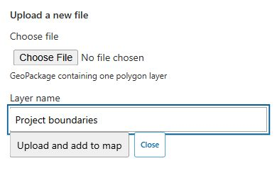

*Bring project boundaries into the same workspace as the shared data.*

Files are stored on the server and available only to the browser that uploaded
them, on that site. **Your uploads** lets you reopen a file. Removing its layer
from the map keeps the file; **Delete uploaded file** removes it. Remembered
maps can restore your upload references, but sending someone a map link does
not give their browser access to your private files.

For an existing Catalog vector or uploaded layer, use **Filter** to narrow the
features, then select that polygon layer when choosing your analysis area.
This is useful for working with one country, watershed or project group without
preparing another file.

## Run data tools and use their results

Open **Tools → Data tools** to clip data, summarize observations or run
environmental models. Choose a tool to select its inputs and analysis area.

Select **Run tool** and follow progress in **Runs** while continuing to use the
map. Closing the panel does not cancel work; use **Cancel run** to stop it.

Download completed results or choose **Show on map** where offered. Some raster
inputs also accept results from earlier runs. **Duplicate with changes** lets
you repeat a run with different choices. Runs belong to your browser session
and have expiry dates: **Keep for another 7 days** extends retention. Download
files you want to keep, since a map link does not preserve the run or share its
private outputs.

## Running your own EOLab workspace

Copy [.env.example](.env.example) to `.env` and fill in its required passwords,
Jobs token and host data-directory path. That file describes the settings;
[docker-compose.yml](docker-compose.yml) defines the services and persistent
volumes. Keep the database password stable after the first deployment and use
distinct volume names for separate deployments.

For a local workspace:

```sh
docker compose -f docker-compose.yml -f docker-compose.local.yml up --build --detach
```

Open `http://localhost:8000`, then scan the data directory from **Status**.
For Coolify, use the repository's Docker Compose build pack and
`docker-compose.yml`, set the variables from `.env.example`, and attach the
public domain to the `app` service on port `8000`. Keep the other services
private. Enable **Include Source Commit in Build** to display the deployed
revision.

Back up persistent volumes before upgrades. Run one `processing-worker`
container and stop the previous one before replacing it: worker startup
interrupts unfinished jobs. Deleting volumes deletes their stored data.

EOLab is open-source software under the [Apache License 2.0](LICENSE). Bivariate
palette definitions originate in the
[ESOS-C data viewer](https://github.com/springinnovate/esos-c-dataviewer), also under
the [Apache License 2.0](https://github.com/springinnovate/esos-c-dataviewer/blob/main/LICENSE).
