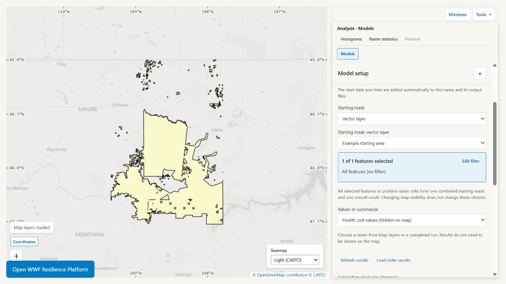

# EOLab

EOLab is a shared browser workspace for exploring, mapping and analyzing
geospatial data. Search a Catalog, bring your own polygons, compare maps through
time, calculate statistics and run models without installing a desktop GIS.

It is especially useful for workshops and collaborative analysis. A facilitator
can publish the participants' datasets once, and everyone can explore the same
material in real time without installing a desktop GIS or creating an account.


*Explore an observation on the map, then choose another date or variable from
the same dataset.*

## What can you do with EOLab

- Find shared raster, vector and temporal datasets in a searchable Catalog.
- Combine layers and change colors, ranges, transparency, categories and labels
  to make patterns easier to see.
- Click to inspect features and pixels; compare distributions with histograms.
- Calculate values, areas and custom formulas for a box or selected polygons,
  compare rasters in a chart, and download the results.
- Explore data time cubes: choose observations, summarize a period into a map,
  or calculate a time series for an area.
- Run models, including downstream ecosystem beneficiaries and Habitat
  condition, and inspect or download their results.
- Upload polygon GeoPackages, filter features, or draw and share polygons with
  names and notes.
- Publish a map link so other people can explore your layers and join shared
  polygon work.

For example, a workshop can compare weather observations, measure conditions
inside selected project areas, and explore which places lie downstream of
proposed restoration sites. Participants can share a map, contribute polygons
and download results for further work.

## A quick tour

### Find a dataset

Use **Catalog search** to enter any part of a filename, path, description, or
date. Ordinary words can be combined with these filters:

- `type:raster` — only raster datasets
- `type:vector` — only vector datasets
- `type:temporal` — datasets containing observations over time
- `format:cog` — only Cloud Optimized GeoTIFFs
- `date:2020`, `date:2020-06`, or `date:2020-06-15` — a year, month, or day
- `date:2020-01..2020-03` — an inclusive date range

For example, `resistance type:raster date:2020` finds raster records containing
“resistance” from 2020. Suggestions appear while you type. Clear the search to
show the complete Catalog, or use **Surprise me** to open a random matching
item.

Each result shows the source filename and the actions you are most likely to
need:

- **Add to map** displays the dataset.
- **More details** opens its Catalog metadata.

After an item is on the map, the same row also offers **Remove**, **Zoom to**,
and **Style** without making you leave the search results.

### Build the map

Open **Map layers** to see the current stack. The first layer in the list draws
on top. Drag a row by its handle to reorder it, or use the keyboard controls on
the same handle.

Use a layer's checkbox to show or hide it, **Zoom to** to find it, and the color
swatch to open its legend. **Add another view** gives the same dataset another
independent set of display choices. **Copy style** and **Paste style** help keep
comparable layers consistent.

Open **Style** to bring out the pattern you care about:

- For continuous rasters, choose a palette and adjust its low, middle and high
  values, colors and transparency. A percentile stretch uses the sampled
  distribution to spread colors across a useful range instead of letting a few
  extreme values dominate.
- For categorical rasters, give classes such as land-cover types their own
  names and colors. Category tables can be imported from CSV.
- For vectors, use one symbol, categories, or numeric classes with editable
  breaks. Turn on **Show labels** when names or values help explain the map.


*Adjust the color range to reveal differences in the data. Styling changes the
appearance of your map, leaving the original values intact.*

### Explore what is under the pointer

A normal click explores the visible data at that location. Dragging still pans
the map.

For visible vectors, EOLab highlights the features under the click and opens
their attributes in **Feature inspector**. Use **Previous** and **Next** when
several features overlap. Clicking empty space does not open an empty result.

For rasters, inspect the value at the clicked pixel or open **Histograms** to
see how values are distributed within a sampling box. Move or resize the box
to explore another area:

- **1D** mode shows distributions for the active visible rasters.
- **2D** mode compares the top two visible continuous rasters and marks them
  **X** and **Y** in Map layers. Reorder those layers to change the pair, or swap
  the axes in the analysis panel. Other layers stay in Map layers but are
  temporarily hidden from the map while 2D mode is active.

A two-variable map combines the X and Y values in one color, helping you
locate combinations such as high values in both layers. Returning to **1D**
restores the individual raster styles.

Use **Axes & scale** to inspect a useful range or switch to logarithmic axes
when values span several orders of magnitude. These controls change the chart
display. They do not change the sampled data or the map's colors. Categorical
rasters show named classes and their ground areas when a matching sample is
available.


*The box identifies the sampled area; the histogram shows which values are
common there. Use Raster statistics for calculated area totals and formulas.*

### Measure an area and compare rasters

Open **Raster statistics** from a layer or **Tools**. Choose the raster inputs,
an area and the statistic you want. One result is shown as a value; several
results can be compared in plots and a table, then downloaded as CSV.

Use a sampling box, selected polygons or each raster's whole extent, depending
on the question. For example, compare mean biomass inside project boundaries,
or measure how many hectares exceed a chosen threshold. Hidden raster layers
can still be selected as calculation inputs.

The built-in choices cover common statistics, counts, areas and percentages.
For a custom formula, `a` means each selected raster in turn:

| Question | Formula |
| --- | --- |
| What is the average valid value in this area? | `mean(a)` |
| How many hectares have values above 10? | `areaha(a > 10)` |
| What percentage of valid pixels have values above 10? | `100 * count(a > 10) / count(a)` |
| What was the value at my last map click? | `pixelValue(a)` |

Choose thresholds in the raster's own units. Missing-data pixels are excluded.
**Pixel value** always refers to the clicked location; changing the analysis
area does not turn it into an average. Up to five formulas can be calculated
together for each raster. The tool's formula reference explains the available
functions.

### Explore data through time

A data time cube brings observations from different dates together as one
dataset. Search with `type:temporal`, add a dataset, and choose its **Variable**,
**Month** and **Date and time (UTC)** in Map layers. Only available observations
are listed. **Add another view** lets you compare dates or variables with
independent styles.

To go beyond one observation, open **Tools → Models**:

- **Map for a period** summarizes observations across your chosen dates into
  a raster, with a second map showing how many observations contributed.
- **Time series for an area** calculates a spatial statistic for each
  observation and returns a CSV. For example, follow mean temperature within a
  watershed over time.

**Raster statistics** also compares observations as a plotted series. Select
the dates for the calculation explicitly; they are independent of the single
observation currently displayed on the map. Missing observations are not filled
in, so check coverage before interpreting a trend or period summary. Ordinary
period statistics weight available observations equally; use **Precipitation
total** when offered to turn rainfall rates into an accumulated depth.

### Make a series plot

After selecting vector features, the inspector offers two complementary plots:

- **Plot fields from this feature** graphs several numeric attributes from the
  current feature. This fits data where fields such as `R2000` through `R2024`
  contain a series within each feature.
- **Plot one field across features** graphs one numeric attribute for every
  feature available through **Previous** and **Next**. Choose the X-axis field
  or filename order, ascending or descending order, and a line or scatter
  chart.


Selecting a chart point identifies its source layer and offers **Zoom to source
layer**. EOLab remembers the plot rules while you inspect other features from
the same layer, so the chart updates instead of making you configure it again.

### Bring your own polygons

Open **Map layers → Polygon uploads…** to add a GeoPackage (`.gpkg`) containing
one polygon layer. Choose the file, give the layer a name, then select **Upload
and add to map**. You can style it, inspect its attributes and filter features,
then use the supported polygon selection in raster analyses or model inputs.


*Bring project boundaries into the same workspace as the shared data.*

Files are stored on the server and available only to the browser that uploaded
them, on that site. **Your uploads** lets you reopen a file. Removing its layer
from the map keeps the file; **Delete uploaded file** removes it. Remembered
maps can restore your upload references, but sending someone a map link does
not give their browser access to your private files.

For an existing Catalog vector or uploaded layer, use **Filter** to narrow the
features, then select that polygon layer when choosing your analysis area.
This is useful for working with one country, watershed or project group without
preparing another file.

### Draw and share polygons

Use **Shared layers → Create layer** to start a shared polygon layer, or **Join
layer** with a share code and your contributor name. Draw polygons, edit their
boundaries, and add names and notes. Everyone sees the saved polygons; you can
edit only your own. **Share layer** copies the code for someone else to join.

**Import GeoJSON** brings simple polygons into an editable local layer saved on
your device. It accepts WGS84 longitude/latitude Polygon features without holes,
including names and notes. Other file attributes and styles are not imported.
Use **Polygon uploads…** for a GeoPackage whose attributes you want to retain.

Drawn or imported polygons can define supported analysis areas. Save edits
before calculating or exporting. **Export GeoJSON** downloads all saved
polygons in the layer, including those hidden by its filter, so you can keep a
copy outside EOLab. Private local polygons are not included in map links; share
them in a shared layer when collaborators need to see them.

### Run a model and explore its results

Open **Tools → Models**, choose a model, select its inputs and area, then choose
**Run model** (or **Run analysis** for the temporal tools). You can keep using
the map while it works. **Runs** shows progress, completed results and **Cancel
run**; closing the panel does not cancel a calculation.

| Model | What you can do |
| --- | --- |
| Raster summary | Calculate statistics and formulas for a selected raster and area; download the values. |
| Raster clip | Download the part of a raster you need as a GeoTIFF. |
| Map for a period | Turn observations over a date range into a summary map. |
| Time series for an area | Download a statistic for each available observation in an area. |
| Downstream ecosystem beneficiaries | Map downstream coverage from a starting area and summarize a values layer within it. |
| Habitat condition | Compare observed habitat conditions with those expected from selected reference sites. |

For **Downstream ecosystem beneficiaries**, choose a **Starting mask** from a
Catalog or uploaded polygon layer, or a Catalog raster whose positive cells
mark the starting locations, then choose **Values to summarize**. For example,
explore downstream coverage from restoration areas and summarize a population
layer within that coverage.
The selected starting areas are combined into one calculation. Inspect the
coverage map, masked values and statistics together; downstream coverage alone
does not demonstrate a measured benefit to everyone within it.



*Choose where the calculation starts and what to summarize downstream.*

**Habitat condition** needs an analysis area, reference sites and raster inputs.
Choose reference sites from a Catalog or uploaded polygon layer, or a raster
whose cells equal to 1 mark the reference sites. Choose your own rasters or
**Original model inputs from Earth Engine** when the deployment is configured
for it. The first Earth Engine run downloads inputs;
later matching runs reuse them. **Reference similarity** ranges from 0 to 1.
Its interpretation depends on your reference sites and scientific settings;
the current configuration follows the Montana Prairie model and is not a
universally validated habitat-quality score. A known display problem affects
its EPSG:6933 output in GeoServer; calculation results can still be downloaded
([tracked here](https://github.com/springinnovate/eolab/issues/1002)).

Completed raster results offer **Show on map** where supported and **Download**.
Once on the map, use the usual styling and analysis tools. Some raster inputs
also let you choose an unexpired result from a previous run; use **Refresh
results** or **Load older results** to find it. Supported choices depend on the
input: for example, the downstream starting mask requires a Catalog raster or
a Catalog/uploaded polygon layer.

Use **Duplicate with changes** to repeat a run with different inputs. Runs and
their files belong to your browser session and have expiry dates. **Keep for
another 7 days** extends retention; download files you need to keep outside
EOLab. A map link does not preserve a run or make its private outputs available
to someone else.

### Share your map

Choose **Publish map** in the workspace header, enter a title and link name,
then select **Create map link**. The resulting page opens your chosen layers,
styles, order, visibility and starting view so others can explore the map
without the Catalog panel. Shared polygon layers remain live: collaborators
see saved changes and can join with the layer's share code. Older **Copy map
link** views may use a link that stores the view directly in the URL.

The browser also remembers the last valid map on that deployment. **Reset
view** returns to an empty map and the configured starting position. **Undo
reset** restores the immediately previous map.

Map links do not include private local polygons, editing credentials,
histogram results, feature plots or processing jobs. Private uploads remain
private, and model-result previews must be reopened from **Runs**. Maps refer
to the deployment's current sources; missing data can prevent full restoration.

## Add your own data

For private polygon files, use [Polygon uploads](#bring-your-own-polygons).
To make datasets available to everyone, an operator adds them to the
deployment's configured, read-only data directory. Treat admitted datasets as
immutable; publish changed data under a new identity. Temporal archives use the
update-and-refresh workflow below.

1. Prepare georeferenced GeoTIFFs and vector datasets before the session.
2. Copy them into the deployment's mounted data directory.
3. Open **Status**, find the Catalog section, and select **Scan directories**.
4. Review any dataset-specific errors without interrupting successful files.
5. Search for a representative raster and vector, add both to the map, and
   verify their bounds and appearance.

To prepare single-band rasters, run [prepare_rasters.py](scripts/prepare_rasters.py)
with a Python environment containing GDAL's `osgeo` bindings (GDAL 3.10 or newer):

```sh
python scripts/prepare_rasters.py "input/*.tif" another.tif --destination prepared
```

It creates EPSG:3857 Cloud Optimized GeoTIFFs named `<name>_cog_epsg3857.tif`,
with compression and overviews. Existing outputs are skipped. Quote glob patterns
so the script expands them consistently across shells; multiple files and patterns
can be combined. From the `scripts` directory, use `python prepare_rasters.py`.
Nearest-neighbor resampling is the default; use `--resampling bilinear` for
continuous data when appropriate. GDAL chooses the projected pixel size and
retains the input data type. Failed conversions are reported and can be retried
by rerunning the command. Distinct inputs must have distinct filename stems.
The destination filesystem must support hard links (for example, NTFS or ext4)
so completed files can be published without overwriting another batch's output.

Scanning again updates files that are still present and removes Catalog items
whose mounted source files have disappeared. The source mount remains
read-only; EOLab stores Catalog metadata and generated GeoServer configuration
elsewhere.

Temporal archives contain prepared GeoTIFF observations and a read-only SQLite
catalog exposing the `observations` view. Copy the complete archive into the
mount with its [dataset.yaml descriptor](docs/dataset-examples/dataset.yaml),
using `source.format: temporal_cog` and a unique dataset `id`, then scan.
The archive appears as one temporal Catalog item; its folder contents are not
indexed separately. Admission reads observation metadata without opening each
GeoTIFF. Missing observations are valid.

Observations share one north-up grid. Publish completed GeoTIFFs before
exposing them in the archive's observation catalog. The
[example temporal item](docs/dataset-examples/era5.item.json) and
[source-access tests](tests/test_temporal_source_access.py) show the metadata
and executable requests without duplicating them here.

Update files only between calculations and rescan before using the updated
data. A failed refresh reports an error and keeps the last valid metadata;
correct the source and complete a successful scan before continuing.

Rendering mounted rasters expects prepared, georeferenced, single-band GeoTIFFs.
EOLab does not rewrite or optimize them during scanning. Temporal map views
publish the selected original GeoTIFF through the same GeoServer pipeline. Mounted
Shapefiles and spatial GeoPackage layers can be added to the map. Other
recognized vector containers may be searchable in the Catalog even when they
are not yet renderable.

## Running your own EOLab workspace

Copy [.env.example](.env.example) to `.env` and fill in its required passwords,
Jobs token and host data-directory path. That file describes the settings;
[docker-compose.yml](docker-compose.yml) defines the services and persistent
volumes. Keep the database password stable after the first deployment and use
distinct volume names for separate deployments.

For a local workspace:

```sh
docker compose -f docker-compose.yml -f docker-compose.local.yml up --build --detach
```

Open `http://localhost:8000`, then scan the data directory from **Status**.
For Coolify, use the repository's Docker Compose build pack and
`docker-compose.yml`, set the variables from `.env.example`, and attach the
public domain to the `app` service on port `8000`. Keep the other services
private. Enable **Include Source Commit in Build** to display the deployed
revision.

Back up persistent volumes before upgrades. Run one `processing-worker`
container and stop the previous one before replacing it: worker startup
interrupts unfinished jobs. Deleting volumes deletes their stored data.

### Upgrade an older published map

Maps saved before removal of Catalog `sourceRevision` fields need a one-time
conversion. The [migration command](src/eolab_app/saved_maps/migrate.py) previews
one named map by default. It removes only those fields, preserves the map URL,
layer order, styles and shared-polygon invitations, and never changes polygons
or contributor ownership. Other incompatible formats cause an error with no
changes; this command does not convert historical raster styles or URL-fragment
links. Run it separately for each affected published map.

For `/maps/nhi-site-condition-mapper`, use the following during a maintenance
window. Have contributors finish saving first. Keep the same database volume,
domain and browser cookies. Build the new application image containing this
command, but stop the old app and worker before applying it: the old app still
requires the removed fields.

```sh
docker compose stop app processing-worker
docker compose exec -T database pg_dump -U eolab -d eolab --format=custom --file=/tmp/eolab-before-map-upgrade.dump
docker compose cp database:/tmp/eolab-before-map-upgrade.dump ./eolab-before-map-upgrade.dump
docker compose run --rm --no-deps --entrypoint python app -m eolab_app.saved_maps.migrate --slug nhi-site-condition-mapper
```

Keep the backup outside container storage and test restoring it to a separate
database before proceeding. The preview reports `changed_layers`, `revision`
and `applied: false`. Review the count, then replace `REVISION` below with that
preview's revision. A conflicting edit requires a new preview. A successful
change increments the map revision once; repeating it is a no-op.

```sh
docker compose run --rm --no-deps --entrypoint python app -m eolab_app.saved_maps.migrate --slug nhi-site-condition-mapper --apply --expected-revision REVISION
```

Complete the deployment using the new images, then open the original shared-map
URL and check its layers, polygon counts and contributor editing access before
reopening the workshop. In Coolify, use the equivalent commands in the existing
deployment with its original persistent volumes; do not create a new deployment
with an empty database. Keep the old image available for rollback.

If verification fails while the maintenance window is still closed, stop the
new app and worker, restore the database backup, and restart the old images.
For example, after copying the backup back into the database container:

```sh
docker compose cp ./eolab-before-map-upgrade.dump database:/tmp/eolab-before-map-upgrade.dump
docker compose exec -T database pg_restore -U eolab -d eolab --clean --if-exists --single-transaction --exit-on-error /tmp/eolab-before-map-upgrade.dump
```

A full restore replaces changes made since the backup, so do not use this
rollback after contributors have resumed editing without reconciling that work.

### Configure models

The downstream model's DEM, watershed layer and topology fields are configured
in its [bundled YAML recipe](src/eolab_app/processing/recipes/downstream-beneficiaries.yaml),
under `steps[0].inputs.hydrology.value`. Set these Catalog references for your
deployment before building it. The pit-filling search cutoff is in
`steps[0].inputs.settings.value.pit_fill_search_limit` in the same recipe;
-1 and 0 allow unlimited searches.

Habitat condition can fetch its original scientific inputs from Earth Engine
inside a model run. Set `EOLAB_HABITAT_EARTH_ENGINE_PROJECT` and
`EOLAB_HABITAT_EARTH_ENGINE_CREDENTIALS_FILE` in Compose. Place the service-account
JSON key in the dedicated `habitat-credentials` volume, readable by the worker's
`eolab` user. Compose mounts that volume read-only at `/run/habitat-credentials`
in `processing-worker` only. For a file named `service-account-key.json`, set the
credential path to `/run/habitat-credentials/service-account-key.json`. Use a
separate `EOLAB_HABITAT_CREDENTIALS_VOLUME_NAME` for each deployment. Keep the key
outside Catalog data and the repository; never put it in browser configuration.
Leave the project and credential-path settings blank to use only manually
selected rasters.

For a first Habitat demonstration, use a representative Montana area and 2018,
with enough reference coverage for the configured spatial validation. The
[model integration tests](tests/test_habitat_earth_engine_model.py) provide an
executable request and result example. Downloaded inputs use nearest-neighbor
resampling; the preparation grid and selected masks' resampling methods remain
explicit choices in the model setup.

Habitat keeps completed input tiles under `PROCESSING_DATA_PATH/habitat-cache`,
beside run files on the same filesystem for atomic publication. Tiles survive run
expiry and restart; administrators may remove the cache only while no calculations
use it. Concurrent cold requests may both download a tile; the first completed
publication wins. Run cleanup removes temporary band views and aligned rasters,
not cached tiles.

EOLab is open-source software under the [Apache License 2.0](LICENSE). Bivariate
palette definitions originate in the
[ESOS-C data viewer](https://github.com/springinnovate/esos-c-dataviewer), also under
the [Apache License 2.0](https://github.com/springinnovate/esos-c-dataviewer/blob/main/LICENSE).
